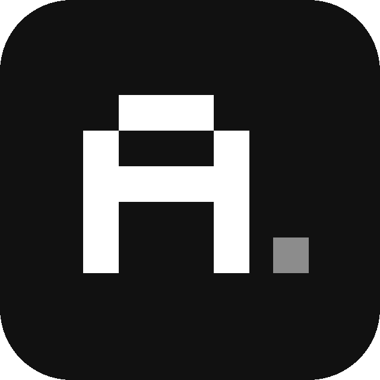
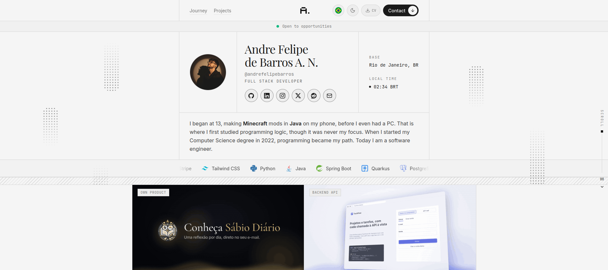
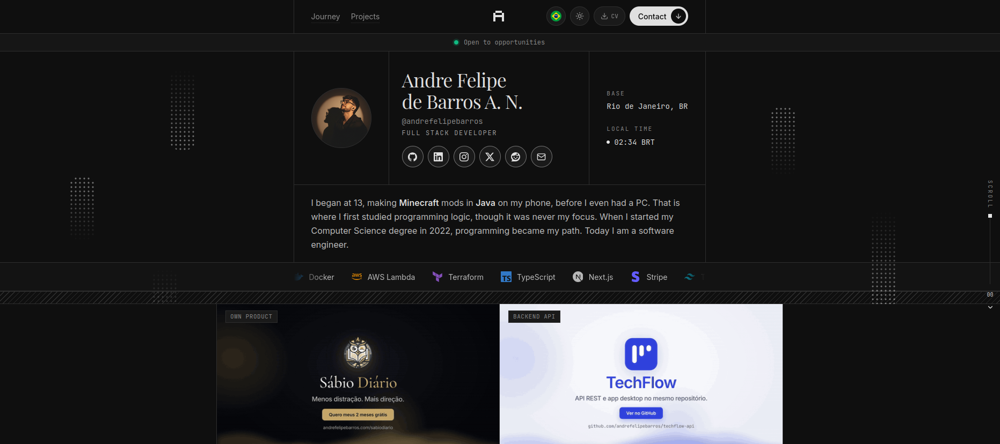
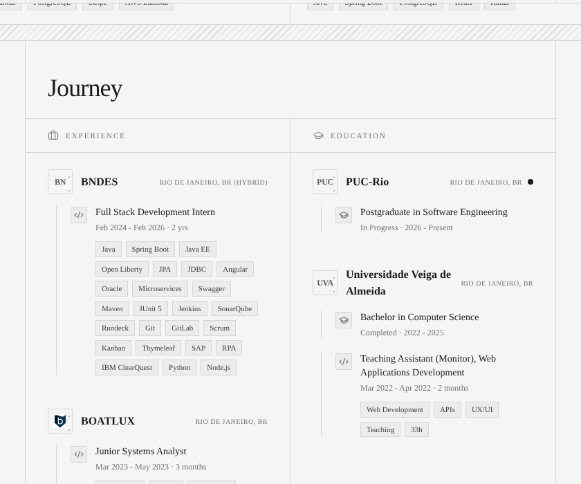

<p align="center">
  
</p>

<h1 align="center">Portfólio de André Felipe de Barros<br><sub><sup><sup><sub>Copyright (©) 2026 André Felipe de Barros</sub></sup></sup></sub></h1>

<p align="center">
  Meu site pessoal: uma página única, em coluna estreita com divisórias hachuradas, que reúne quem eu sou, minha trajetória, meus projetos e um botão para baixar o currículo.<br>
  Abre no tema claro, troca para o escuro com um clique e fala português e inglês.<br>
  Sem banco de dados e sem back-end: todo o conteúdo mora em arquivos de texto do próprio repositório.
</p>

<p align="center">
  <strong>Versão 4.0.0</strong> · Next.js 16 (App Router) · React 19.2 · TypeScript · Tailwind CSS 3.4 · next-themes · lucide-react · pnpm · Netlify
</p>

---

> **Para quem quer só ver funcionando:** rode `pnpm install` e `pnpm dev`, abra [http://localhost:3000](http://localhost:3000) e passe o mouse pelo site. O rastro de bolinhas, as bolinhas que acendem nos painéis e o botão **Contact** respondem ao cursor.

> **Quer reaproveitar a ideia?** Os textos, fotos, logos, currículo e GIFs são meus: troque tudo pelos seus dados em `lib/translations.ts`, `lib/projects-data.ts` e `public/` antes de publicar a sua versão.

<p align="center">
  
</p>

## O que o site mostra

- **Cabeçalho fixo:** links para Journey e Projects, logo em pixel art, troca de idioma com bandeiras redondas, botão **CV** (versão pública, sem telefone), troca de tema e o botão **Contact** com brilho e seta animados.
- **Faixa "Open to opportunities":** logo abaixo da barra, com um ponto verde pulsando.
- **Apresentação:** foto do GitHub (com iniciais caso a imagem não carregue), nome em fonte serifada, usuário, cargo, ícones de GitHub, LinkedIn e e-mail, base, hora local atualizada ao vivo e um texto curto sobre mim.
- **Faixa de tecnologias:** logos e nomes rolando sem parar, com pausa para quem pede menos movimento.
- **Destaques:** dois cartões mais largos que a coluna, que "saem" das linhas da página, com um GIF de demonstração, descrição e as tecnologias de cada projeto.
- **Trajetória (Journey):** duas colunas, Experiência e Formação, com logo de cada empresa e escola, localização, modelo de trabalho, período e etiquetas de tecnologia. A monitoria fica dentro da formação.
- **Certificações e prêmios:** só as principais, com etiqueta de **Em andamento** onde ainda não terminei, e uma seção própria para premiações da faculdade.
- **Projetos:** grade estática de quatro cartões, sem efeito de rolagem, cada um com capa pontilhada, logos das tecnologias e links para o código.
- **Contato:** e-mail em destaque, cartão para baixar o currículo (`cv.pdf`) e links para GitHub, LinkedIn e e-mail.

## Detalhes de interface

- **Duas aparências:** claro por padrão (preto e branco), escuro por escolha de quem visita. A escolha fica salva no navegador.
- **Dois idiomas:** português e inglês, com a troca feita pelo cabeçalho e toda a cópia centralizada em `lib/translations.ts`.
- **Efeitos de bolinhas:** rastro de bolinhas atrás do mouse, pequeno estouro ao clicar, painéis pontilhados que acendem ao redor do cursor e colunas de pontos flutuando nas laterais das telas largas.
- **Indicador de rolagem:** linha vertical na borda direita com a porcentagem e uma seta que some no fim da página.
- **Logos com plano B:** cada empresa, escola e emissor tenta primeiro um arquivo local em `public/logos`, depois ícones públicos pelo domínio e, por último, um monograma.
- **Movimento sob controle:** animações respeitam a opção de reduzir movimento do sistema, e os efeitos do mouse só existem em dispositivos com mouse (nada disso aparece no celular).
- **Revelação ao rolar:** as seções aparecem suavemente quando entram na tela, com `IntersectionObserver`.

<p align="center">
  
</p>

<p align="center">
  
</p>

## Como rodar

Pré-requisitos: **Node.js 20.9 ou mais recente** (recomendada a versão LTS) e [pnpm](https://pnpm.io/).

```bash
git clone https://github.com/andrefelipebarros/My-Site.git
cd My-Site
pnpm install
pnpm dev
```

Abra [http://localhost:3000](http://localhost:3000).

Para gerar a versão de produção:

```bash
pnpm build
pnpm start
```

| Comando | O que faz |
|---|---|
| `pnpm dev` | Servidor de desenvolvimento (com Turbopack) |
| `pnpm build` | Gera a versão de produção |
| `pnpm start` | Serve a versão de produção |

> A fonte Playfair Display, usada nos títulos, e as fontes Inter e JetBrains Mono são baixadas pelo `next/font` na hora do build. Sem internet, o build falha: rode com acesso à rede.

## Onde mudar cada coisa

| Quero mudar | Arquivo |
|---|---|
| Textos, cargo, experiências, formação, prêmios, contato | `lib/translations.ts` (um bloco em inglês e outro em português) |
| Projetos e suas tecnologias | `lib/projects-data.ts` |
| Quais projetos aparecem na grade | lista `FEATURED` em `components/projects.tsx` |
| Quais projetos viram destaque e seus GIFs | `highlights.items` em `lib/translations.ts` e `IMAGES` em `components/highlights.tsx` |
| Certificações | `lib/certifications-data.ts` |
| Logos de empresas e escolas | `lib/org-logos.ts` e arquivos em `public/logos/` |
| Logos de tecnologias | `lib/tech-icons.ts` e arquivos em `public/tech/` |
| Ícones das redes sociais e links | lista `socials` em `components/hero.tsx` |
| Currículo para baixar | `public/cv.pdf` (mantenha o nome) |
| Cores e tema | variáveis no início de `app/globals.css` |

## Estrutura

```text
app/
  page.tsx                  ordem das seções da página
  layout.tsx                fontes, tema inicial (claro), idioma e efeitos de cursor
  icon.svg                  favicon (o "A" em pixel art)
  globals.css               tokens de cor (claro e escuro), hachura, painéis pontilhados e animações
components/
  navigation.tsx            cabeçalho, idioma, tema, botão CV e botão Contact
  open-banner.tsx           faixa "Open to opportunities"
  hero.tsx                  foto, nome, redes sociais, base, hora local e texto de apresentação
  tech-ticker.tsx           faixa de tecnologias rolando
  highlights.tsx            os dois cartões largos com GIF
  journey.tsx               experiência e formação
  certifications.tsx        certificações com etiqueta "em andamento"
  awards.tsx                premiações
  projects.tsx              grade de projetos (e o componente TechLogo)
  contact.tsx               e-mail, cartão do currículo e links
  column.tsx                a coluna central, as divisórias e o rótulo de seção
  reveal.tsx                revelação ao rolar e título de seção
  org-logo.tsx              logos de organizações com plano B
  pixel-cursor.tsx          rastro de bolinhas, estouro ao clicar e brilho dos painéis
  scroll-progress.tsx       indicador de rolagem na lateral
  side-decor.tsx            colunas de pontos nas laterais
  pixel-mark.tsx, flags.tsx logo em pixel art e bandeiras em SVG
  ui/                       componentes base (shadcn/ui)
lib/
  translations.ts           todo o texto do site, em português e inglês
  projects-data.ts          projetos e tecnologias
  certifications-data.ts    certificações
  org-logos.ts              mapa de logos de organizações
  tech-icons.ts             mapa de logos de tecnologias
  brand-icons.ts            ícones das redes sociais (Simple Icons, CC0)
  locale-context.tsx        contexto de idioma
public/
  cv.pdf                    currículo
  highlights/               GIFs dos destaques
  logos/, tech/             logos e ícones locais
docs/images/                imagens deste README
```

## Decisões de projeto

- **Conteúdo em arquivos, não em componentes:** textos, projetos e certificações ficam em `lib/`, então trocar um cargo ou um projeto não exige mexer em JSX.
- **Cores por variáveis:** o tema é um conjunto de tokens HSL em `:root` e `.dark`, lidos pelo Tailwind. Os efeitos usam os mesmos tokens, então funcionam nos dois temas sem código extra.
- **Claro por padrão:** o `next-themes` abre sempre no tema claro e ignora a preferência do sistema, deixando a troca para quem visita.
- **Efeitos só com mouse:** o rastro e o brilho dos painéis dependem de `(pointer: fine)`, evitando custo e ruído em telas de toque.
- **Revelação e rolagem sem biblioteca:** `IntersectionObserver` para aparecer ao rolar e um ouvinte passivo de `scroll` para o indicador, sem dependências extras.
- **Logos em camadas:** arquivo local, depois ícone por domínio, depois monograma. Para trocar uma logo, basta colocar o arquivo em `public/logos` e apontar em `lib/org-logos.ts`.
- **Bandeiras em SVG:** emoji de bandeira aparece como letras no Windows, então as bandeiras do idioma são desenhadas à mão.
- **Sábio Diário no mesmo domínio:** o `netlify.toml` faz um proxy de `/sabiodiario` para o site do produto, mantendo o endereço `andrefelipebarros.com/sabiodiario`.

## Limitações conhecidas

- Os GIFs dos destaques pesam cerca de 3 MB cada. Carregam só perto da tela, mas um vídeo em loop seria mais leve e mais nítido.
- Há um único currículo, em português, usado nos dois idiomas.
- O `next.config.mjs` ignora erros de tipo no build (`ignoreBuildErrors`). Rode `pnpm exec tsc --noEmit` para conferir os tipos por conta própria.

## Versões anteriores (legado)

Este repositório passou por uma grande refatoração. A versão antiga do site continua preservada em **tags** do Git.

- Abra a aba [Tags](https://github.com/andrefelipebarros/My-Site/tags) no GitHub e procure por `v1.0.0` ou `backup-legacy`.
- Ou, pelo terminal: `git checkout <nome-da-tag>`.

## Contribuindo

Este é um projeto pessoal, mas sugestões e feedbacks são bem-vindos. Abra uma *issue* ou fale comigo pelo [LinkedIn](https://www.linkedin.com/in/andrefelipebarros/).

## Autor

- [André Felipe de Barros](https://github.com/andrefelipebarros), criador e mantenedor.

## Referências técnicas

- [Next.js App Router](https://nextjs.org/docs/app)
- [Tailwind CSS](https://tailwindcss.com/)
- [next-themes](https://github.com/pacocoursey/next-themes)
- [Simple Icons](https://simpleicons.org/)

## Licença

Distribuído sob a licença MIT. Veja o arquivo [`LICENSE`](LICENSE).
